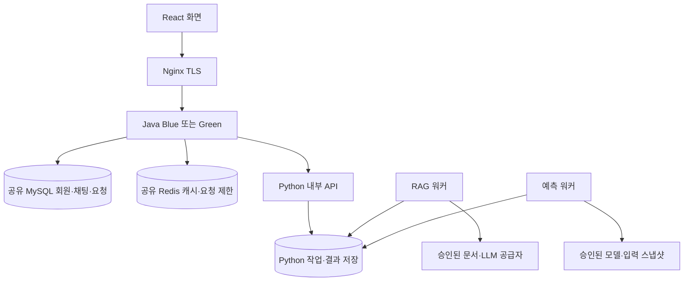

# 현재 설계 (2026-11-17 KST)

사용자 결정: **Java doChallenge가 CAMT 공시 수집·검색·LLM 초안·검토·공개 결과와 Kafka 생산·소비를 소유한다.** Python ShockGarph_AI는 예측·가격 연구를 담당한다. Python #18의 문서 해시·출처·인용·사람 검토 규칙은 Java 구현에 선별 재사용한다. 현재 Java BriefingGateway는 Python 결과를 읽는 이전 구현이며 Java RAG·Kafka 작업은 미구현이다.

구현 순서: 역할 문서 정렬 → Java 21/Spring Boot·Spring AI 호환성 및 회원·채팅 회귀 → CAMT 수집·문서 저장 → Java 검색·LLM 초안·사람 검토·DB 조회 → Java Kafka 생성 작업 및 실제 브로커 재시작·중복 시험 → React 기존 GET 응답 인수. Kafka에는 작업 ID·자료 스냅샷 등의 참조만 보내고 외부 LLM 호출 중복 가능성을 별도로 관리한다. 기존 GET 응답 계약과 미검토 비공개 정책을 유지한다. 기존 11/18·11/20 계획은 새로운 Java 완료 약속이 아니다.

아래의 Python RAG/예측 설계는 **2026-11-16 당시 이력**이다. RAG 역할, 데이터 소유, 후속 구현 순서에서 이 절의 결정보다 우선하지 않는다. 예측 모델 명세·시점·검증 조건은 향후 별도 연구에 참고한다.

---

# 공통 API와 확장 가능한 AI·예측 모델 구조

기준일: 2026-11-16. 상태: 설계 결정, 신규 예측 기능은 미구현.
이번 결정은 사용자 요청인 친구의 딥러닝 모델 연동을 반영한다. 기존 RAG 브리핑·차트·회원·채팅을 유지하며, 모델 준비와 검증은 브리핑 출시의 선행 조건으로 추가하지 않는다.

실제 확장 가능성은 [부하·장애 검증 계획](09-load-and-failure-validation.md)의 기준선·교차 앱 채팅·자원 간섭·전후 비교를 통과한 범위에서만 주장한다. 구조 분리만으로 처리량이나 무중단을 보장하지 않는다.

## 역할과 의존성

doChallenge는 제품의 공통 API이며 회원·권한·사용량·사용자 요청을 소유한다. HTTP 경로를 무조건 전달하는 프록시로만 만들지 않는다. Python은 데이터 수집·RAG·예측 계산을 소유하고, React는 Java가 제공하는 사용자용 계약을 소비한다. 승인된 외부 가격 위젯은 기존처럼 브라우저에서 별도로 표시할 수 있다.

화살표는 호출 또는 저장소 접근이다. Python API가 작업을 영속 기록하면 해당 워커가 이를 가져가 처리한다. 이 그림은 목표 구조이며 현재 운영 연결 완료를 뜻하지 않는다.

| 구성 | 소유하는 책임 | 경계 |
|---|---|---|
| shockgraph-web | 종목 선택, 브리핑·예측·작업 상태 화면 | 모델 키·내부 토큰·학습 코드 없음 |
| doChallenge | 회원·이메일·관심 목록·채팅, 요청 권한·한도·사용자용 결과 | 학습·벡터 검색·GPU 추론을 Java 요청 스레드에서 실행하지 않음 |
| ShockGarph_AI 내부 API | 모델별 지원 기능, 작업 접수·상태·검증된 결과 조회 | 사용자 JWT·이메일·회원 DB 직접 접근 없음 |
| RAG 워커 | 공시 수집·검색·LLM 요약·근거 검증 | 미래 주가 수치를 임의 생성하지 않음 |
| 예측 워커 | 승인된 모델 로딩·전처리·추론·결과 저장 | 회원 관리나 채팅을 알 필요 없음 |
| 별도 학습 환경 | 친구가 모델 학습·평가·버전 제작 | 웹 요청과 분리, 첫 배포에 GPU 서버를 자동 추가하지 않음 |

처음에는 Python의 한 저장소에 모듈을 나누고 워커를 별도 프로세스로 실행한다. 친구가 독립 저장소를 유지할 경우에도 버전이 고정된 패키지나 컨테이너를 어댑터 뒤에 연결한다. 서비스 수나 저장소 수를 미리 늘리지 않는다. 프레임워크 의존성·GPU 요구가 다를 때 별도 워커 이미지 또는 승인된 별도 실행 호스트로 분리한다.

## 현재 구현과 계획의 구분

2026-11-16 조회 기준 원격 main: Java `553d113`, Python `a993373`, 웹 `f64feb8`.
Java #23, Python #18, 웹 #9는 모두 미병합 초안이다.

- Java #23: `BriefingController`·`BriefingGateway`의 공개 GET → 내부 FastAPI 읽기 연결. 내부 토큰·시간 제한·응답 크기 제한·동시 호출 상한 구현.
- Python #18: CAMT 공시 수집, 문단 검색, 초안 생성 경로, 사람의 검토를 거친 결과의 파일 저장·조회. 실제 공급자 LLM 실행과 공개 통합 배포는 미검증.
- 웹 #9: 브리핑 패널·상태·출처 표시와 응답 검증. 연결 설정을 별도로 적용해야 한다.
- 아래의 모델 목록·예측 API·영속 작업·아웃박스·별도 추론 워커는 계획이다. 기존 초안 시험을 새 기능 시험으로 계산하지 않는다.

## RAG와 수치 예측은 별도 제품 계약

- 브리핑: 최근 자료의 요약, 긍정·부정 근거, 출처·발표 시각. 소식의 방향성 해석이다.
- 예측: 특정 시점에 확정한 입력으로 특정 미래 구간의 가격·수익률·변동성 중 명시한 하나를 계산한 결과다.
- 두 출력을 하나의 상승 확률이나 점수로 합치지 않는다. 화면도 '최근 소식'과 '실험적 모델 전망'을 분리한다.
- 예측을 LLM의 사실 근거로 연결할 경우에는 검증된 구조화 결과만 사용하며 관측 사실과 모델 추정치를 구분한다. 첫 버전에는 이 연결이 필요 없다.

## 예측 모델이 제공해야 할 명세

아키텍처 이름이 LSTM·Transformer인지보다 아래 항목이 먼저다. 아직 친구의 모델 명세를 받은 상태는 아니다.

| 항목 | 필요한 정의 |
|---|---|
| 식별 | model_id, model_version, artifact_digest, input_schema_version |
| 대상 | 지원 티커·거래소·통화, target_type(price/return/volatility), 단위·조정가격 여부 |
| 시각 | prediction_at, data_cutoff_at, available_at, target_start_at, target_end_at, 거래소 달력·시간대 |
| 입력 | 사용 특징·순서·빈도·과거 길이·결측 허용·정규화기·기업행위 처리, 스냅샷 ID·해시 |
| 출력 | 예측값·단위·지평, 모델 버전·입력 해시, 불확실성 산출 방식과 검증 여부 |
| 실행 | 추론 명령·라이브러리 버전·CPU/GPU·최대 RAM·추론 시간·예제 입력·기대 출력 |
| 평가 | 학습 종료 시각·평가 구간·기준선·재현 절차·사용 데이터의 공개 허용 범위 |

'5일'은 5달력일인지 5거래일인지 명시한다. 정규화기는 학습 데이터만으로 적합한 같은 버전을 제공한다. 예측 시점보다 늦게 이용 가능해진 자료와 학습에 포함된 미래 정답을 입력에 섞지 않는다. 신뢰구간·상승 확률이 검증되지 않았으면 수치를 만들어 채우지 않고 미제공으로 반환한다.

## API와 오래 걸리는 작업 처리

아래는 경로 초안이며 이번 변경으로 새 엔드포인트가 구현되지는 않는다.

| Java 공개 API | 역할 |
|---|---|
| GET /api/v1/models | 사용 가능한 모델·지원 종목·목표·예측 기간·검증 상태 |
| POST /api/v1/forecast-jobs | 인증·한도·지원 조합 확인 후 요청 접수, 202와 job_id |
| GET /api/v1/forecast-jobs/{id} | 요청 회원의 권한 확인 후 실행 상태 조회 |
| GET /api/v1/forecasts/{id} | 권한과 공개 정책을 통과한 불변 결과 조회 |
| GET /api/v1/briefings/{symbol}?window=7d | 기존 브리핑 조회 계약 유지 |

Java가 입력 종목·모델·허용 기간을 검증하고 사용자 요청과 아웃박스 행을 하나의 DB 트랜잭션으로 기록한다. 전달 작업자는 내부 인증 HTTP로 Python에 접수하며, Python은 고유 요청 ID를 중복 방지 키로 영속 저장한다. 응답 유실 때 같은 ID로 재전달해도 계산이 중복 생성되지 않아야 한다. 초기에는 별도 브로커 없이 이 경로를 먼저 검증한다.

Python 작업자는 DB lease와 만료 복구를 사용하고 처리 시도 식별자로 결과를 조건부 기록한다. lease가 만료된 이전 작업자가 나중에 완료해도 현재 결과를 덮어쓸 수 없어야 한다. 완료 결과와 성공 상태는 하나의 트랜잭션으로 저장한다. 모든 재시도·동시 실행·대기열 길이에 상한을 둔다.

실행 상태(queued/running/succeeded/failed)와 평가 상태(not_evaluated/hold/validated)는 별도다. 계산에 성공했다고 미래 예측 성능까지 검증된 것은 아니다. 사용자별 작업 접근 권한은 캐시와 중복 합치기 이후에도 검사한다. 공유 결과를 사용하더라도 다른 회원의 작업 존재 여부·ID는 노출하지 않는다.

## 데이터 소유와 배포

- Java Blue/Green은 동일한 회원·채팅 MySQL과 Redis를 사용한다. 모델 워커는 이 DB 테이블을 읽거나 수정하지 않는다.
- Python 제품 작업·결과는 기존 브리핑 계획의 별도 MySQL 스키마·최소 권한 계정으로 시작한다. 기존 연구 메타데이터의 PostgreSQL 정책과 원본 객체 저장 경로는 별개로 유지한다. 벡터 검색 때문에 Java DB를 이전하지 않는다.
- Redis는 캐시·요청 제한 용도이며 작업과 결과의 유일한 영속 저장소가 아니다. 서비스별 키·권한·자원 사용량을 구분한다.
- 모델 파일은 버전·해시가 고정된 승인된 아티팩트만 로딩한다. 사용자 파일·임의 경로·URL을 모델 로더에 전달하지 않는다. 큰 바이너리를 Java 저장소에 커밋하지 않는다.
- 기존 4GB EC2에 딥러닝 모델이 들어간다고 가정하지 않는다. 모델 단독 추론과 Java 두 버전·MySQL·Redis 동시 실행의 최대 메모리를 측정한 뒤 배치 위치를 정한다. GPU·새 유료 호스트가 필요하면 별도 결정 사항이다.
- 모델 교체는 Java 배포와 분리한다. 대기 모델의 고정 입력 시험 후 버전 매핑을 바꾸고, 실패하면 이전 버전으로 되돌린다. 기존 결과는 생성 당시 모델 버전을 유지한다.
- Python 장애 때 Java 회원·채팅의 상태 검사가 실패하도록 연결하지 않는다. 추론 전용 동시성·타임아웃·회로 차단을 두고, 마지막 결과를 제공할 때는 기준 시각과 오래됨을 표시한다. 공유 호스트·DB의 자원 경합은 별도 부하 시험 없이는 격리가 입증되지 않는다.

## 구현 순서와 완료 판단

1. 현재 브리핑 PR 통합·실제 통신과 회원·채팅 회귀. 새 예측 모델이 없어도 진행한다.
2. 친구의 명세·고정 예제 수령. 자원 측정과 Python 모델 어댑터 단독 시험. 여기까지는 모델 성능 입증이 아니다.
3. Java 작업·권한·중복 방지·아웃박스와 Python 영속 작업·추론 연결. 테스트용 응답은 비공개 테스트 환경에서만 사용한다.
4. React 모델 목록·작업 상태·기준 시각·전망 카드 연결. 배포된 화면 확인과 실제 미래 성능 검증은 따로 보고한다.
5. 결과 정확성·권한 분리·장애 복구·모델 교체·Java Blue/Green 회귀 후 승인된 실험 범위에서 공개한다.

시험에는 타인 작업 조회 거부, 중복 접수, 전달 후 응답 유실, 워커 종료·재기동, 오래된 작업자 덮어쓰기 거부, 미지원 모델/종목/기간, 데이터 누수, 모델 버전 불일치, NaN/무한대·단위 오류, 공유 DB 보존을 포함한다.

가격 예측이면 직전 가격 유지, 수익률이면 0 또는 학습 구간 기준 예측, 변동성이면 최근 변동성/EWMA처럼 목표에 맞는 기준선과 같은 시간순 구간에서 비교한다. 실제 매매로 확장한다면 비용·회전율·낙폭은 별도 평가가 필요하다. 독립 미래 정답이 없으면 성능 HOLD를 유지한다.

## 다음 담당자가 확인할 경로

- 현재 Java 연결: src/main/java/com/fitmeet/briefing/BriefingController.java, BriefingGateway.java, src/main/resources/application.yml.
- 추가할 Java 모듈: src/main/java/com/fitmeet/forecast/{presentation,application,domain,infrastructure}/ (미구현).
- Python 현재 PR #18: apps/briefing_api/shockgraph_briefing_api/app.py, packages/briefing/shockgraph_briefing/.
- Python 추가 모듈: packages/forecasting/ 및 apps/forecast_worker/ (경로 제안, 미구현).
- 웹 현재 PR #9: src/features/briefing/; 추가할 src/features/forecasting/ (미구현).
- 친구에게 받을 자료: 모델 설명서·의존성 파일·전처리/추론 코드·버전 고정 모델·민감 정보 없는 예제 입력/기대 출력. 비밀키나 비공개 원본 가격을 채팅/공개 PR로 받지 않는다.
