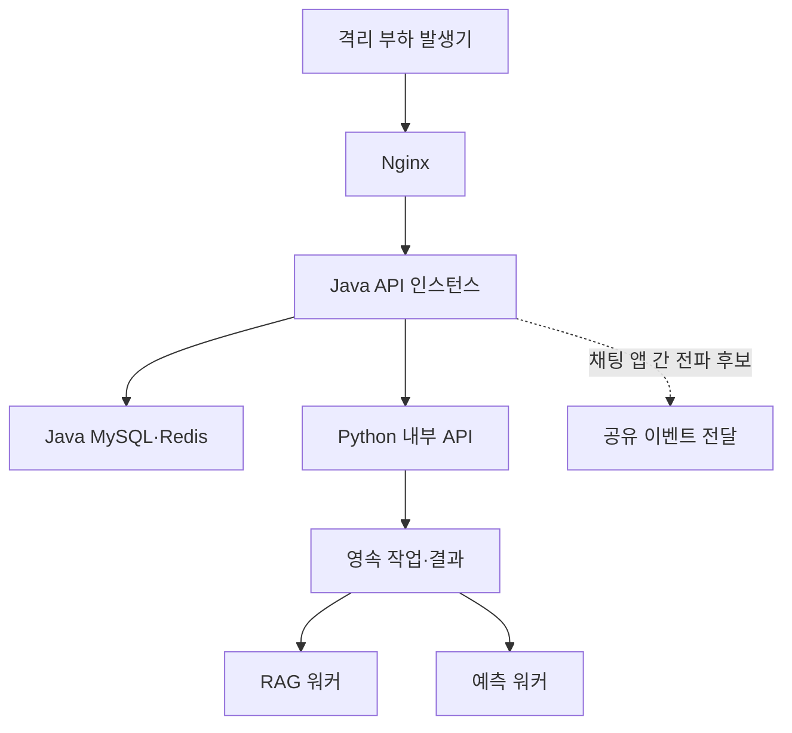

# 부하 측정과 장애 시험으로 검증하는 확장 구조

기준일: 2026-11-16. 상태: 실행 계획. 부하 도구·계측·분산 방송을 이번 문서로 구현하거나 운영 검증한 것은 아니다.

## 기준 자료와 보완 이유

사용자가 제공한 [토스 Learner’s High 자료 적용 요약본](../references/toss-learners-high-server-3-adoption-plan.md)(2026-10-27 작성, 289줄)을 [공통 API·모델 확장 설계](08-core-api-and-model-extension.md)와 대조했다. `docs/references/`의 요약본은 당시 제안을 보존하는 참고 문서다. 현재 실행 범위와 시험 기준은 이 계획과 [현재 제품 방향](../current-product-direction.md)을 따른다. 아래 페이지 번호는 요약본의 출처 표기를 따르며, 원본 PDF는 저장소에 포함하지 않았다. 기존 [배포 후 트러블슈팅 전략 PR #18](https://github.com/AnDev77/doChallenge/pull/18)은 별도 미병합 초안이다.

요약본의 핵심은 문제 재현 → 변경 전 측정 → 대안 선택 → 작은 변경 → 같은 조건 재측정 → 복구 검증이다. 앞선 확장 설계는 책임·작업·모델 계약을 정의했지만 실행 가능한 부하 조건과 개선 채택 기준이 부족했다. 이 문서가 그 공백을 보완한다.

과거 요약본의 Next.js·SPY/TLT 중심 화면, Java 채팅 여부 미정, Kafka 일괄 제외는 최신 사용자 결정으로 대체한다. 현재는 React·QQQ/SPY 채팅·Java 공통 API·Python RAG/예측이며 Kafka는 필요성을 검증할 수 있는 후보로 열어 둔다. 새 브로커를 이번 문서만으로 설치하지 않는다. 비공개 기록 전체 업로드 금지와 연구 HOLD는 그대로 유지한다.

| 요약본 항목 | 현재 코드·설계의 근거 | 추가할 시험·적용 판단 |
|---|---|---|
| DB 정합성·멱등성(p.6) | 금융 메시지 유일 제약, 작업 아웃박스·lease 설계 | 동시 중복, 커밋 순서, 부분 실패, 이전 작업자의 늦은 완료 |
| 캐시·버전·hotkey(p.5) | 금융방은 현재 DB 조회, 브리핑은 내부 HTTP 조회 | 캐시 없음/비어 있음/채워짐, 특정 종목 집중, 만료 동시 발생, 버전 경합 |
| 네트워크·장애 격리(pp.7–8) | 브리핑 접속·읽기 제한, 인스턴스당 8개 동시 호출 | 느린 응답·429·연결 중단과 채팅 부하 동시 측정 |
| CPU·메모리(p.9) | RAG/추론 워커 분리 계획 | API 단독/추론 추가/Blue·Green 동시 자원 비교 |
| 로그·메트릭(p.10) | 별도 계측 보완 필요 | 계층별 시간·오류·풀 대기·작업 나이·메모리 관측 |
| 인증·테스트(pp.11–12) | 서버 principal·채팅 인증 시험 | 타인 작업 조회·다중 세션·실제 MySQL/Redis 회귀 |
| 이벤트·재처리(p.4) | 프로세스 내부 SimpleBroker | 두 앱의 방송·DB 복구·이벤트 재전달, 후보별 비용 |

## 확장할 수 있는 경계와 아직 해결되지 않은 점

이는 시험·확장 목표 그림이다. Blue/Green은 배포 전환 방식이며 처리량을 자동으로 늘리거나 EC2 장애까지 해결하는 구조는 아니다. 현재 `WebSocketConfig`는 SimpleBroker를, `FinanceChatService`는 DB 커밋 후 해당 프로세스의 방송을 사용한다. 서로 다른 앱에 연결된 두 사용자의 실시간 수신은 공유 MySQL만으로 충족되지 않는다. DB 저장 성공 뒤 앱 종료로 방송이 누락되는 경우도 DB 재조회와 대조해야 한다.

먼저 현재 앱의 재접속·누락 복구를 검증한다. 이후 활성 앱을 여러 개 운영하거나 Blue/Green 장기 소켓을 공존시킬 때 공유 전파 방식을 비교한다. Redis Pub/Sub는 중단 중 메시지를 보관하는 역할로 사용하지 않으며 DB 복구를 유지한다. Streams/Kafka를 택하면 소비자 그룹의 작업 분배와 각 앱의 방송 수신을 별도로 설계하고 outbox·중복 처리·재처리·lag·종료 처리를 검증한다. 동시 연결 고정(sticky routing)만으로 전체 방 방송 문제를 해결했다고 하지 않는다.

RAG와 예측 작업에는 각자 동시성·대기열·공급자 한도를 둔다. 워커 수만 늘렸을 때 DB·GPU·외부 API가 먼저 포화되면 확장이 아니다. 하나의 EC2·MySQL을 공유할 경우 컨테이너 분리만으로 자원 격리가 입증되지 않는다.

## 시험 환경과 계측 도구

- 전용 Compose 프로젝트·합성 계정/문서/가격·별도 볼륨을 사용한다. 운영에서 대량 SMTP·유료 LLM 호출·장애 주입을 실행하지 않는다. 실 LLM·모델은 작은 고정 입력의 별도 인수 시험으로 지연/품질/비용을 확인한다.
- HTTP 부하 발생기는 k6를 후보로 한다. STOMP는 WebSocket 연결 성공만 세지 않고 CONNECT/SUBSCRIBE/SEND와 실제 수신을 검사하는 드라이버를 준비한다. 현재 레포에 이 성능 하네스가 있다고 가정하지 않는다.
- Java 계측은 Micrometer, 대시보드는 Prometheus/Grafana를 후보로 한다. 최초 측정은 구조화 로그·컨테이너 통계로 시작할 수 있다. Python 작업 단계별 시간도 같은 실험 ID로 연결한다. 도입 시 버전·메모리·노출 범위를 별도 검증한다.
- 부하 발생기는 가급적 서버와 다른 호스트에 둔다. 같은 호스트라면 발생기의 CPU 경쟁과 관측 도구의 비용을 기록하고 서버 한계로 일반화하지 않는다.
- 기록 항목: 커밋·이미지 digest·JVM/모델 버전·서버 사양·컨테이너 한도·MySQL/Redis 버전·행 수·스냅샷 해시·캐시 상태·동시성·실제 요청률·수행 시간. 실제 비밀값과 사용자 본문은 기록하지 않는다.
- 추적 ID·job ID는 제한된 로그 연결용이다. 메트릭 라벨에는 경로 템플릿·서비스·상태 등 제한된 값을 사용하고 회원·작업 ID를 넣지 않는다.

## 부하 조건과 판단 기준

초기 실험안이며 달성 실적이나 지원 인원 보장이 아니다. 동시 사용자 1 → 10 → 30으로 시작해 여유가 있을 때만 100까지 올린다. 각 단계는 1분 준비 후 5분 측정, 같은 조건을 최소 3회 반복한다. 오래 실행되는 실제 모델은 완료 작업 수와 관측 시간을 별도 설계하며 5분으로 충분하다고 가정하지 않는다.

조회 부하와 작업 생성 부하는 분리한다. 조회는 1/5/10/30 요청·초처럼 고정 도착률도 추가하고, 목표·실제 요청률·부하 발생기가 시작하지 못한 요청 수를 함께 기록한다. 서버가 느려져 발생 요청 자체가 줄어드는 상황을 성능 개선으로 세지 않는다. 작업 접수율·완료율·가장 오래 기다린 작업의 나이를 함께 본다. 측정 구간에 대기열이 계속 늘어나면 접수 API가 빨라도 지속 가능한 처리량이 아니다.

| 시나리오 | 입력과 비교 조건 | 측정·통과 판단 |
|---|---|---|
| 조회 기준선 | 고정 결과와 금융 메시지 1만/10만 건, QQQ/SPY 분산·QQQ 집중 각각 | p50/p95/p99·쿼리 수·풀/잠금 대기·성공 응답 비율. 초기 목표: 30명 조회 p95 1초 이하 |
| 캐시 전후 | 같은 데이터/부하에서 없음·cold·warm, 조회 범위 동일 | 지연·DB 호출·적중률·메모리 비교. 최신 스냅샷/권한 불일치 0건, p99·오류 악화 시 미채택 |
| 동일 작업 동시 접수 | 여러 합성 회원이 같은 입력/모델 요청, 같은 idempotency key 재전송 포함 | 요청 소유권 유지, 같은 의미의 계산이 불필요하게 증폭되지 않음. 다른 회원 작업은 조회 불가 |
| 채팅 기본·다중 세션 | 한 회원의 두 세션, 두 종목·집중 방, 30건 초과 누락 후 재연결 | 저장된 기대 ID와 수신/복구 ID 대조. 유실·중복 표시·타인 사칭 0건을 시험 범위에서 확인 |
| 채팅과 추론 간섭 | 동일 채팅 부하에서 모델 없음/느린 모형 공급자/실제 단일 모델 비교 | 채팅 p95·오류·CPU/RSS·DB 대기. 초기 채택 기준: p95 악화 20% 이내이면서 기능별 절대 목표 충족 |
| 작업자 종료·응답 유실 | 접수 저장 직후 응답 차단, 작업 도중 종료, lease 만료 후 이전 시도 완료 | 영속 작업 회수, 종료된 시도의 결과 덮어쓰기 거부, 공개 결과·권한·모델 버전 보존 |
| 캐시 동시 만료·Redis 장애 | 여러 요청의 같은 키 미스, 갱신 중 새 결과 확정 | DB 우회 폭증을 제한. 인증/요청 제한 저장 장애는 임의 허용하지 않고 캐시 장애와 구분 |
| Blue/Green | 서로 다른 두 앱 버전, 공유 DB/Redis, 한 세션 blue·다른 세션 green | 상태 검사→실 API/채팅→전환→재접속·복구→실패 복귀. 같은 회원·메시지·결과 ID 보존 |

전체 목표: 정상 부하의 예기치 않은 5xx/논리 실패 1% 미만, 정합성 실패 0건. 과부하 시 의도된 429/503은 별도 집계하되 성공 처리량에 포함하지 않는다. 인증 실패/보류/자료 부족도 성공한 브리핑으로 세지 않는다. 기존 `BriefingGateway`는 HTTP 200 안에 `status=failed`를 반환할 수 있으므로 HTTP 코드만 검사하면 실패를 놓친다. 테스트는 응답 상태·내용·기준 시각을 함께 확인한다.

채팅 실시간 표시 목표는 STOMP의 저장 완료→수신 p95 1초, 기존 5초 폴링 경로는 별도로 7초 이내를 제안한다. 서버와 클라이언트 시계 차이를 통제하거나 같은 측정기의 단조 시계로 왕복 시간을 측정하고 이름을 구분한다. 목표가 충족되지 않으면 실제 값을 기록하며 목표를 사후 변경해 통과로 만들지 않는다.

OOM·데이터 정합성 오류·작업 폭증·디스크 여유 급감 시 증가를 즉시 중단한다. 정상 시나리오에서 오류율 1% 초과나 p95 목표 초과가 60초 지속되면 해당 단계를 실패로 기록하고 원인을 확인한다. 의도된 장애 실험의 오류는 별도 시나리오로 집계한다.

## 병목별 적용 순서

| 관측한 병목 | 먼저 적용·비교할 변경 | 확장 조건 |
|---|---|---|
| DB 조회·잠금 | 실행 계획, 복합 인덱스, 페이지 크기, 트랜잭션 범위 | 같은 결과를 유지하며 검사 행·대기·지연 감소 |
| 반복 읽기·동일 종목 집중 | 확정 결과 버전 캐시, 동시 채우기 제어 | 키에 모델/입력/스키마·공개 상태 포함, 캐시가 최신 포인터 갱신을 역전시키지 않음 |
| 느린 Python/LLM | 호출·동시성 상한, 제한 재시도, 작업 분리, 회로 차단 후보 | 회원·채팅 목표를 유지하고 실패/대기 상태를 정직하게 반환 |
| 추론 CPU/GPU·메모리 | 프로파일링, 모델 1회 로딩, 워커 한도, 모델별 큐 분리 | 모델 정확성 회귀 없이 지연·메모리 개선; 추가 호스트는 별도 자원 결정 |
| 앱 간 채팅 전파 | 공유 이벤트+DB 복구, 필요하면 outbox | 양 색상·재시작·재전달·순서·소비자 분배를 실제 검증 |
| 지속적 작업 지연·여러 소비자 | DB 작업 방식과 메시지 브로커 비교 | Kafka 등은 처리 지연·재처리·운영 비용의 전후 증거로 채택 |

금융 결과 캐시는 확정된 스냅샷별 불변 키로 저장하고 최신 포인터와 공개 권한을 확인한다. 기존 공개 브리핑의 HTTP `no-store`를 임의로 해제하지 않고 서버 내부 캐시부터 검토한다. Redis 자체가 원본 결과나 사용자 권한의 유일한 저장소가 되지 않는다.

3회 반복은 변동을 관찰하기 위한 최소 실험이며 통계적 유의성의 증거가 아니다. 같은 조건에서 한 가지 변경씩 비교하고 각 시행의 표본 수·중앙값·범위를 남긴다. 개선이 없으면 되돌린 결과도 기록한다. 부하 성능, 운영 배포 성공, RAG 사실 정확성, 주가 예측 정확성은 각각 판정한다.

## 다음 구현 카드와 확인할 코드

1. 현재 통합 경로를 대상으로 계측 + 격리 합성 공급자 + 조회 부하 하네스를 만든다. 후보 경로 `performance/README.md`, `performance/scenarios/`, `performance/fixtures/`, `performance/results/`는 아직 미생성이다. 토큰·실가격·실회원 없이 재현 가능하도록 한다.
2. 기준선을 측정한 후 하나의 병목을 선택해 작은 PR에서 개선하고 같은 부하로 비교한다. Redis 캐시·Kafka·워커 증설을 한 PR에 묶지 않는다.
3. 별도 채팅 교차 앱 전파·재접속 시험을 구현해 Blue/Green 인수와 연결한다. 마지막으로 실제 모델과 제한된 입력의 인수를 수행한다.

현재 읽을 경로:
- `src/main/java/com/fitmeet/briefing/BriefingGateway.java`: 동시성·timeout·논리 실패 상태.
- `src/main/java/com/fitmeet/financechat/FinanceChatService.java`: DB 커밋 후 방송·중복 요청·페이지 처리.
- `src/main/java/com/fitmeet/financechat/FinanceMessageRepository.java`: 최근 조회·afterId 쿼리.
- `src/main/java/com/fitmeet/common/config/WebSocketConfig.java`: SimpleBroker와 실시간 연결.
- `src/test/java/com/fitmeet/financechat/FinanceMessageRepositoryTest.java`: 실제 MySQL 동시성 검증으로 확장할 출발점이며 현재 시험만으로 고부하 검증을 주장하지 않는다.

성과 기록은 `문제/기준선/대안/변경/같은 조건의 결과/복구/미검증 범위` 순서로 새 기능 리뷰에 남긴다. 실행하지 않은 성능 칸은 미측정으로 유지한다. 원본 부하 결과는 비공개 데이터가 섞이지 않았는지 검토한 뒤 공개하며 기존 비공개 진행·트러블슈팅·검증표 전체는 업로드하지 않는다.
