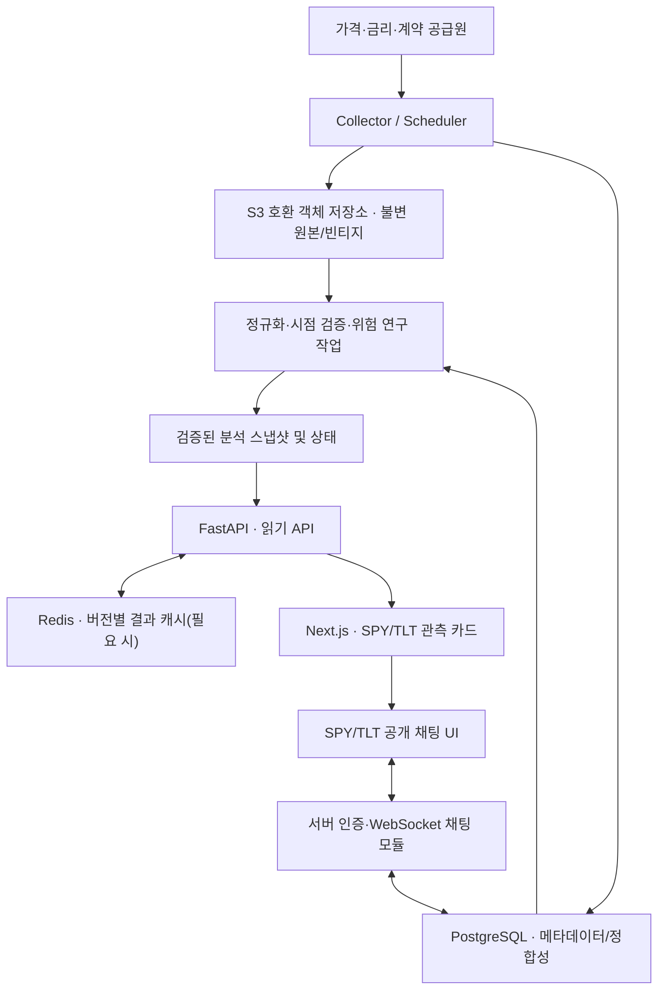

# ShockGraph AI — 토스 Learner's High 서버 3기 자료 적용 계획

> **문서 성격:** 기존 개발 대화에 전달하기 위한 **기술 설계·실행 제안서**. 구현 지시 확정본이나 구현 완료 보고서가 아니다.  
> **작성일:** 2026-10-27  
> **기준 자료:** Viva Republica, *Learner's High 서버 3기 세션자료*, pp. 3–16  
> **프로젝트:** [AnDev77/ShockGarph_AI](https://github.com/AnDev77/ShockGarph_AI)  
> **상태 근거:** 2026-10-27에 확인한 저장소 `README.md`, `AGENTS.md`, `docs/product-ui-direction.md`, `docs/project-flow.md`, `docs/shareholder-community-roadmap.md`, `docs/autonomous-development-scorecard.md`.

> **현재 구현과의 대조:** 이 문서는 당시 제안으로 보존한다. 2026-11-19 기준 Java 저장소의 실제 적용 여부와 미검증 항목은 [원본 PDF 대조·구현 근거표](learners-high-implementation-map.md)를 참조한다. 아래의 과거 Kafka/RabbitMQ·DB·Python 역할 제약은 최신 사용자 결정과 구현 상태가 아니다.

## 0. 기존 ShockGraph AI 개발 대화에 전달할 요청

**이 문서를 기존 ShockGraph AI 개발 계획에 반영하되, 바로 전체 구현을 시작하거나 기존 연구·제품 방향을 임의 변경하지 말 것.** 먼저 다음을 수행한다.

1. `main`의 최신 코드, 진행 문서, 열린 초안 PR을 읽고 이 문서의 제안 중 **이미 구현된 것 / 미구현 / 현재 범위 밖**을 구분한다.
2. `AGENTS.md`의 금융 데이터 정확성, 데이터 권리, 멱등성, 검증 절차와 21일 개발 계획·기존 작업 흐름을 우선한다. 서로 충돌하는 제안은 기존 제약을 적용하고 충돌 내용을 명시한다.
3. **사용자가 이용할 수 있는 SPY·TLT 관측 화면과 공개 채팅**을 계속 추진한다. TLT 5·20거래일 위험 예측 연구는 별도 검증 흐름으로 유지하고, 실증 전에는 성능을 발표하지 않는다.
4. 즉시 필요한 세 가지 기술 도전을 우선 적용한다: **원본·예측 기록 정합성 및 멱등성**, **분석 API 캐시와 성능 측정**, **채팅 인증·다중 세션 안정성**. 외부 금융 API 장애 대응과 관측 가능성도 함께 설계한다.
5. 변경은 작은 PR로 분리하고, 각 PR에 문제 재현 → 변경 전 측정 → 기술 선택 근거 → 구현 → 장애/부하/회귀 시험 → 변경 후 측정 → 한계·남은 작업을 기록한다. 수치가 없으면 목표와 계획만 적고 성과처럼 표현하지 않는다.

---

## 1. 요약: 토스 자료에서 가져갈 것은 '기술 목록'이 아니라 '문제 해결 방식'

토스 세션은 Kafka, Cache, DB/Storage, Network, MSA/Service Mesh, CPU/Memory, 로그·메트릭, 보안/인증, 테스트·배치·워크플로, AI 기반 개발·운영을 주제로 **요구사항이 높아질 때 무엇을 관찰하고 어떤 트레이드오프를 고려했는가**를 설명한다(pp. 3–13).

특히 특별전형 설명에서는 **아키텍처의 변화**, **높은 기술적 도전**, **밀도 있는 수행 과정**을 강조한다(pp. 15–16). 이 관점은 ShockGraph AI에도 유용하다. 단, 토스가 사용하는 대규모 기술을 그대로 모방한다는 뜻은 아니다. **현재 발생한 문제와 검증 가능한 부하를 먼저 정의한 뒤 필요할 때 최소한의 기술을 도입**한다.

### 프로젝트가 증명해야 할 세 가지 축

- **금융 데이터 엔지니어링:** 과거 데이터의 가용 시각, 수정가격 빈티지, 원본 해시, 중복 수집과 사후 정답 채점의 정합성을 보장한다.
- **프로덕션 백엔드:** API 지연과 실패를 측정하고, 필요한 경우 검증된 결과를 캐싱하며, 외부 공급원 장애에서도 허위·오래된 결과를 최신 정보처럼 내보내지 않는다.
- **실시간 사용자 서비스:** SPY·TLT 종목별 카드와 공개 채팅을 제공하고, 메시지 영속성, 재연결, 다중 세션, 인증·인가를 검증한다.

사용자 가치 검증과 취업용 기술 포트폴리오의 증명은 서로 보완하지만 **동일한 지표가 아니다**. 합성 테스트 통과는 금융 모델의 실측 성능을 뜻하지 않고, 채팅 사용자 수는 위험 예측의 우수성을 입증하지 않는다.

## 2. 현재 상태와 절대 유지할 제약

### 2.1 확인된 기존 구현·연구 기반

- SPY·TLT 가격 및 TLT 위험 연구를 위한 수집·시점 검사·평가 로직이 있다.
- 원본 응답/수정가격 빈티지의 불변 보관, 해시·무결성 검사, 동일 거래일 중복 수집 생략, 공식 평가 빈티지 선택 및 합성 저장소 평가 등 작업 기록이 있다.
- 예측 당시 사용 가능했던 가격·지표와 미래 정답을 분리해 검증하도록 설계되어 있다.
- 2026-10-27에 확인한 개발 문서 기준, **실가격 기반 공개 가능한 예측 실증은 HOLD**, 사용자용 웹 화면·공개 채팅은 아직 구현되지 않은 단계다. 저장소 상태는 다음 작업 전에 반드시 재확인한다.

### 2.2 `AGENTS.md`와 충돌해서는 안 되는 원칙

- **Kafka·Kubernetes를 MVP에 추가하지 않는다.** 별도의 운영 조직을 요구하는 MSA로 분리하지 않고, 모듈형 저장소와 독립 실행 작업 프로세스를 유지한다.
- 필요성이 검증되고 불변 원본·영속 아웃박스가 준비됐을 때에만 승인된 **RabbitMQ** 도입을 고려한다.
- 메타데이터·예측 기록·평가 결과는 **PostgreSQL**, 시계열 요구는 PostgreSQL/TimescaleDB 우선, 원본·모델 바이너리는 **S3 호환 객체 저장소(R2 등)** 인터페이스로 저장한다.
- **Redis는 검증된 API 결과의 캐시** 용도이며 금융 원본의 기준 저장소(SSOT)가 아니다. 토스 슬라이드의 `write-behind`와 Redis-SSOT 사례를 그대로 이식하지 않는다.
- 모든 시장 시각은 UTC로 저장한다. 모델 입력은 `available_at <= prediction_at`을 충족해야 한다. 5·20일 정답의 중첩·같은 거래일 중복 기록을 독립 표본으로 세지 않는다.
- 가격·Kalshi·기타 금융 데이터의 이용권과 표시권이 검증되지 않은 내용을 외부 서비스에 임의 공개하지 않는다. 실증되지 않은 모델 성능이나 합성 예시값을 실제 성과로 보여주지 않는다.
- 실시간 거래·주문 실행·개인화된 매매 권유는 범위 밖이다.
- 향후 채팅 인증/권한은 클라이언트가 보낸 회원 ID가 아닌 서버에서 검증한 principal을 사용한다. 보유 인증 채팅방은 허가된 공급원이 확보된 뒤 별도로 검토한다.

---

## 3. 적용 우선순위 표

| 자료 주제/페이지 | ShockGraph 적용 아이디어 | 우선순위 | 도입 조건 |
|---|---|---|---|
| DB/Storage 멱등성·복합 인덱스 (p. 6) | 수집·예측·채점의 중복 방지, 메타데이터 유일성, 쿼리 인덱스 | **P0** | 현재 보관 모델·공식 평가 빈티지 규칙에 맞게 설계 |
| Cache 정합성·운영 지표 (p. 5) | 분석 스냅샷 버전별 캐싱, hit rate, invalidation | **P1** | 실제 읽기 API 구현 및 기준 지연 측정 후 |
| 로그·메트릭 (p. 10) | 수집 실패율·데이터 freshness·API p95·캐시 적중률 관측 | **P0/P1** | 민감 원본·키/개인정보 로그 배제 |
| Network·MSA 장애 격리 (pp. 7–8) | 외부 API timeout, 제한된 retry, backoff, circuit breaker 후보 | **P1** | 실제 호출 장애 패턴과 재시도 안전성 확인 |
| 보안·인증 (p. 11) | 로그인, WebSocket CONNECT/SUBSCRIBE/SEND 권한, 기본 rate limit | **P1** | 공개 채팅 MVP 구현 시 필수 |
| 테스트·워크플로 (p. 12) | 실제 DB 통합 시험, dry-run, 장애 주입, 수집 워크플로 재현 | **P0/P1** | 기존 Python/DB 도구에 맞게 적용 |
| Kafka 고처리량·DLQ (p. 4) | 큐를 도입할 경우의 메시지 중복·DLQ·graceful shutdown 원칙만 선반영 | **P2** | 반복적 처리 지연과 운영 필요성이 확인될 때 |
| CPU/Memory 프로파일링 (p. 9) | 실제 부하에서 프로파일러·메모리 측정 | **P2** | CPU/메모리 병목이 실측될 때 |
| AI 개발·운영 (p. 13) | 자동 코드 리뷰/분석·사후 품질 게이트·근거 남기기 | **P1** | 모델 결과·로그의 민감도와 비용을 확인 |

**판단:** 처음부터 모든 기술을 쌓기보다 `데이터 정합성 → 사용자 API와 캐시 → 로그인·채팅 → 장애·성능 시험`의 순서가 제품 가치와 개발 역량을 모두 드러낸다. 기존 예측 연구 파이프라인은 병행하되 별도 품질 게이트를 유지한다.

---

## 4. 핵심 기술 도전 A — 금융 데이터 정합성과 멱등 처리

**참조:** Kafka 중복 재발행·멱등 컨슈머(p. 4), DB 정합성·잠금·이종 트랜잭션(p. 6).

### 문제 정의

- 동일 거래일을 두 번 수집했을 때 원본과 예측이 불필요하게 중복될 수 있다.
- 서로 다른 수신 시각의 수정가격 전체 스냅샷은 **같은 거래일이라고 단순 중복 취급할 수 없다**. 서로 다른 빈티지는 의미 있는 감사 이력이다.
- 사전 예측과 사후 정답의 공식 빈티지 선택이 달라지면 모델 평가가 변경될 수 있다.
- 객체 저장소에 원본을 저장하고 PostgreSQL에 메타데이터를 기록하는 두 단계 중 일부가 실패할 수 있다.

### 제안

1. **도메인별 중복 정의를 명문화한다.** 수집 요청 재실행, 원본 스냅샷 빈티지, 거래일별 공식 예측, 평가 결과 아티팩트의 식별자를 분리한다.
2. 동일 입력·동일 실행 요청은 멱등하게 처리하되, 유효한 새 캡처 시각·새 가격 버전은 이력으로 보존한다.
3. PostgreSQL `UNIQUE` 제약과 원자적 트랜잭션으로 공식 평가 레코드의 중복을 차단한다. 이미 객체 스토리지에 저장한 바이트는 해시·키를 통해 대조한다.
4. 객체 저장소와 DB 사이에 부분 실패가 발생하면 **불완전 상태를 표시하고 재시도·복구 가능하게** 한다. 분산 트랜잭션을 제공한다고 주장하지 않는다.
5. 필요하면 영속 아웃박스 패턴을 검토하되, 브로커는 실제 요구가 생긴 후 도입한다.

### 완료 검증 기준

- 같은 작업을 여러 번 반복하거나 동시에 요청해도 **공식 예측과 독립 시작일 수가 증가하지 않는다**.
- 중간 실패 후 재실행했을 때 원본의 무결성이 유지되고 누락된 메타데이터를 복구할 수 있다.
- 서로 다른 가격 빈티지는 별도로 보존되고, 공식 평가에서 무엇을 선택했는지 추적된다.
- 저장소의 기존 `HOLD`와 외부 공개 제한 상태를 바꾸지 않는다.

**보고할 측정값:** 중복 차단된 실행 수, 실제 보관된 고유 거래일 수, 실패/복구 사례, DB 충돌 건수, 원본 해시 감사 결과. *숫자는 테스트한 뒤 채운다.*

## 5. 핵심 기술 도전 B — Redis 캐시 및 분석 API 성능

**참조:** Remote–Local 정합성, 캐시 버전 관리, hit rate·hotkey·운영 관측(p. 5), CPU/Memory 절약(p. 9).

### 적용 대상

- `GET /v1/market/assets/{symbol}?window=60` 등 SPY·TLT 과거 관측 화면의 **검증된 결과 스냅샷**.
- 복잡한 계산이나 DB 조회가 반복되는 구간만 우선 캐시한다. 캐시가 꼭 필요한지는 기본 API 응답시간과 데이터 용량을 측정해 판단한다.

### 안전한 캐시 설계

- 키 예시: `asset:SPY:window:60:snapshot:<snapshot_id>:schema:v1`.
- 결과 JSON에 데이터 기준 시각, 원본·계산 버전, 상태(`ready` / `stale` / `insufficient_data` 등)를 포함한다.
- 동일 화면에서 기준 시각이 다른 SPY와 TLT 카드가 잘못 비교되지 않도록 응답 계약을 검증한다.
- 새 스냅샷이 확정되면 **버전이 다른 새 키를 사용**하고, 오래된 결과의 노출·만료 규칙을 명확히 한다. 캐시 무효화 실패 시에도 원본·메타데이터의 정확성이 우선이다.
- TTL, 캐시 미스, 일시적 Redis 장애, 캐시 stampede를 테스트한다. Redis 장애가 금융 원본 손실이 되어서는 안 된다.

### 완료 검증 기준

- 같은 테스트 데이터와 같은 API 부하 조건에서 캐시 전·후를 비교한다.
- p50/p95 지연, 초당 요청 수, DB 호출 횟수, Redis hit rate, 메모리 사용량을 기록한다.
- `snapshot_id`가 변경된 뒤 이전 값이 최신값으로 잘못 보이지 않는다.
- Redis 연결을 차단해도 API가 안전하게 **DB/승인된 스냅샷 조회** 또는 명확한 오류/지연 상태로 폴백한다.

**주의:** 성능 향상률(예: 35%)은 이번 프로젝트의 실측치가 아니다. 과거 다른 프로젝트의 수치를 ShockGraph 결과로 전용하지 않는다.

## 6. 핵심 기술 도전 C — 공개 종목 채팅의 인증·다중 세션 안정성

**참조:** 네트워크 연결·idle timeout(pp. 7–8), JWT 등 인증(p. 11). 직접적인 채팅 설계는 프로젝트의 `docs/product-ui-direction.md`, `docs/shareholder-community-roadmap.md`를 따른다.

### 먼저 출시할 채팅 범위

- SPY·TLT **공개 채팅**: 비로그인 읽기, 로그인한 회원의 글쓰기.
- 영속 메시지 저장, 커서 기반 페이징, WebSocket 실시간 전송.
- 신고·차단·삭제·기본 전송 제한 및 운영 기록.
- **인증 주주** 표시나 실제 종목 보유 인증은 하지 않는다(후속 별도 계약·권한 설계).

### 구현 시 검증할 기술적 과제

1. **인증:** 클라이언트가 전달한 사용자 ID 대신 JWT/세션에서 서버가 검증한 주체를 사용한다.
2. **권한:** 메시지 조회와 실시간 구독·전송에서 동일한 방 접근 규칙을 적용한다. 향후 보유 인증 방이라면 CONNECT/SUBSCRIBE/SEND 및 권한 만료·취소까지 검증해야 한다.
3. **다중 세션:** 동일 회원이 브라우저/기기 여러 곳에서 접속·종료·재연결해도 연결 관리가 꼬이지 않는지 확인한다.
4. **재연결:** 연결 단절 후 메시지 ID/커서를 사용해 빠진 메시지를 조회해 복원한다. WebSocket 자체에 exactly-once 전달을 보장한다고 표현하지 않는다.
5. **중복 전송:** 사용자가 같은 요청을 재시도할 때 `client_message_id`와 회원·방 범위의 멱등 처리를 검토한다.
6. **운영:** 대량 전송·도배·차단 우회 등 비정상 행위를 rate limit과 신고/운영 정책으로 제한한다.

### 완료 검증 기준

- 다중 브라우저/기기, 동시 송신, 새로고침, 네트워크 차단/복구의 통합 시험 결과를 남긴다.
- REST와 WebSocket 경로의 **인증 우회·타인 사칭·권한 누락** 시험을 통과한다.
- 서버가 재시작된 이후에도 저장된 메시지를 커서 기반으로 다시 조회한다.
- 실제 보유 인증을 완료하기 전에는 '인증 주주' UI를 제공하지 않는다.

**기술 선택:** 채팅을 기존 FastAPI 모듈로 구현할지 별도 Spring Boot 경계로 둘지는 운영 복잡도, 코드 재사용성, 성능/보안 비용을 비교해 결정한다. 이전 `doChallenge` 코드의 클라이언트 지정 `memberId` 신뢰와 미검증 `/topic` 구독을 그대로 가져오면 안 된다.

## 7. 외부 금융 API 장애 주입 및 관측 가능성

**참조:** HTTP connection/idle timeout(p. 7), circuit breaker·bulkhead·rate limit·fault injection(p. 8), 로그/메트릭(p. 10).

### 장애 시나리오

| 상황 | 기대 처리 | 검증 대상 |
|---|---|---|
| 공급자 API `429` | 공급자 정책을 지키는 제한 재시도와 backoff | 무한 재시도·요금 급증 방지 |
| `500` / timeout | 호출 시간 한도·안전한 재시도, 실패 원인 기록 | 작업이 무기한 멈추지 않음 |
| 응답 스키마 오류 | 파싱·품질 검사 실패, 승인되지 않은 값 저장 금지 | 오류 데이터 격리 |
| 원본 저장 후 DB 기록 실패 | 부분 실패 상태 기록과 재처리 | 원본 해시/메타데이터 정합성 |
| 데이터 갱신 지연 | 마지막 검증 스냅샷에 `stale` 명시하거나 `insufficient_data` 제공 | 최신 분석으로 오인 방지 |
| Redis 장애 | 읽기 폴백 또는 명확한 오류 응답 | 캐시 장애가 원본 손실로 이어지지 않음 |

### 최소 관측 항목

- **데이터 수집:** 공급자별 성공/실패/429/timeout, 원본 수신 UTC, 누락 거래일, 중복 차단 횟수, 감사 실패.
- **분석:** 예측 origin, 데이터 빈티지, `available_at` 제약 위반, 정답 성숙 여부, 모델 버전, 검증·공개 상태.
- **API:** 요청 수, p50/p95 응답시간, 오류율, 캐시 hit/miss, 스냅샷의 freshness.
- **채팅:** 활성 연결, 재연결, 영속 저장 실패, 재전송 중복 차단, 신고/차단 이벤트.
- **보안:** 인증/권한 실패 건수. API 키·토큰·사용자 민감 정보·원문 금융 라이선스 데이터를 로그에 노출하지 않는다.

Circuit Breaker, 분산 추적, 중앙 로그 시스템은 **기본 메트릭만으로 원인 파악이 부족할 때** 도입한다.

---

## 8. 제안 아키텍처 — 목표 상태 (구현 완료 아님)



- 이는 **목표 배치도**이지 현재 이미 배포된 구성도가 아니다.
- 분석 요청 시 재학습하지 않는다. 연구 결과의 공개 여부는 별도 검증 게이트를 따른다.
- `Kalshi` 확률은 계약 참가자의 당시 기대를 보여주는 **맥락 데이터**다. 승인 없이 TLT 위험 예측의 필수 입력·성능 근거로 승격하지 않는다.
- 채팅과 분석 결과의 근거를 UI에서 명확히 분리한다.

## 9. 작은 PR 단위 실행 로드맵

| 순서 | 제안 작업 | 산출물/인수 조건 | 성격 |
|---|---|---|---|
| **0** | `main`·열린 PR·현재 작업 카드 대조 | 기존 구현/중복/충돌 목록, 우선순위 결정 | **먼저 실행** |
| **1** | 공개 SPY·TLT 관측 카드용 최소 API·화면 | 로그인 없이 출처·시각·누락·권리/지원 상태 확인 | 제품 MVP |
| **2** | 메타데이터 멱등/복구 하드닝 | 중복·동시성·부분 실패 시험, 공식 표본 수 안정성 | 핵심 백엔드 |
| **3** | API 성능 기준선 → 필요 시 Redis | 캐시 전후 p50/p95·DB 쿼리·hit rate 비교 | 성능 검증 |
| **4** | 로그인·종목별 공개 채팅 | 영속 메시지, 커서 조회, WS, 신고/차단/전송 제한 | 제품 MVP |
| **5** | 다중 세션·재연결·권한 시험 | 장애 재현, 메시지 복원, 사칭·권한 우회 차단 | 안정성/보안 |
| **6** | 공급자 장애 주입·대시보드 | 429/timeout/부분 실패 처리, freshness·오류율 관측 | 운영 역량 |
| **병행** | TLT 위험 연구·사후 평가 | 5·20거래일 정답 성숙·실표본 축적, 모델 성능은 실증 전 `HOLD` | 연구 검증 |

> 현재 작업에 이미 포함된 단계는 중복 실행하지 않는다. PR 순서와 시점은 사용자가 지정한 작업 범위, 기존 21일 계획 및 최신 저장소 상태에 따라 조정한다.

### PR별 표준 보고 형식

```markdown
## 문제
- 사용자/시스템에서 발생하는 실제 문제와 재현 조건

## 변경 전 근거
- 로그/실패 테스트/성능 기준선/원본 데이터 시점

## 기술적 선택
- 선택한 접근과 대안, 선택 이유 및 운영 비용

## 변경 내용
- 바뀐 모듈·API·데이터 계약

## 검증 결과
- 자동 테스트 / 통합 시험 / 장애 주입 / 성능 수치
- 실자료, 합성 자료, 미검증 조건을 구분

## 제약과 후속 작업
- 아직 재현·검증하지 못한 것, 제품/연구의 HOLD 여부
```

기존 `AGENTS.md`에 따라 `make quality`, `make test`, PR 자동 품질 게이트를 확인하고, `docs/progress.md` 및 `docs/troubleshooting.md`, 핵심 기능명 리뷰 파일에 변경 전후를 남긴다.

## 10. 포트폴리오에 남길 증거

- [ ] 중복 수집 및 동일 거래일 중복 공식 평가를 차단한 **실패 시험과 개선 후 검증**
- [ ] R2 객체와 PostgreSQL 메타데이터의 **부분 실패·복구 실험**
- [ ] Redis 전후의 **p95 응답시간/쿼리 수/캐시 적중률 측정**
- [ ] 외부 API `429`·timeout·스키마 오류의 **장애 주입과 오류 격리 결과**
- [ ] WebSocket **다중 기기·재연결·메시지 중복·권한 우회 시험**
- [ ] 도입하지 않은 기술(Kafka, Kubernetes, 별도 MSA)에 대한 **트레이드오프 설명**
- [ ] 최종 **아키텍처 Before/After**, API·데이터 계약, 공개 데모와 한계

**성과 문장 작성 원칙:** `문제 → 원인 분석 → 선택한 구조 → 구현 → 실측 개선/안정성 → 잔여 한계` 순서로 기록한다. 성능 개선율, 정확도, 장애 복구 시간, 사용자 수는 실제 측정 후에만 사용한다.

---

## 11. 참고자료와 출처 구분

### 사용자 제공 자료에서 직접 가져온 항목

- *Learner's High 서버 3기* p. 3: 높은 요구사항, 호기심을 갖고 질문하기.
- p. 4: Kafka 배치·병렬 처리, 리밸런싱·메시지 순서, DLQ, 멱등성, graceful shutdown, lag 모니터링.
- p. 5: 캐시 구조·remote/local 정합성, hotkey, Lua 원자성, 캐시 버전업, 운영 메트릭. **Redis-SSOT 사례는 이 프로젝트에 적용하지 않음.**
- p. 6: DB 파티셔닝/복합 인덱스, idempotency key, lock, DB-Kafka 이종 트랜잭션 및 분산락 고려점.
- pp. 7–8: timeout, 네트워크 장애 분석, tracing, circuit breaker·bulkhead·rate limit, shadow/dry-run, fault injection.
- p. 9: profiler/perf/eBPF, 메모리·압축 최적화.
- p. 10: 로그 구성, 비차단·실패 대응, 로그 비용.
- p. 11: API key, OAuth2, mTLS, JWT, HMAC 서명, 키 교체, 서비스 호출 통제.
- p. 12: Testcontainers, 아키텍처 규칙 검사, dry-run, 배치·워크플로.
- p. 13: 코드 리뷰·운영·분석 자동화, MCP/CLI 기반 AI 개발 환경, AI 비용·품질.
- pp. 15–16: 토스식 선택이 유일한 정답이 아님, 아키텍처 변화·높은 목표·밀도 있는 기술 경험의 가치.

### 프로젝트 근거(2026-10-27 조회)

- [README.md](https://github.com/AnDev77/ShockGarph_AI/blob/main/README.md)
- [AGENTS.md](https://github.com/AnDev77/ShockGarph_AI/blob/main/AGENTS.md)
- [현재 흐름 및 구현 상태](https://github.com/AnDev77/ShockGarph_AI/blob/main/docs/project-flow.md)
- [제품 및 화면 설계](https://github.com/AnDev77/ShockGarph_AI/blob/main/docs/product-ui-direction.md)
- [채팅·보유 인증 후속 설계](https://github.com/AnDev77/ShockGarph_AI/blob/main/docs/shareholder-community-roadmap.md)
- [자동 개발 점검 기록](https://github.com/AnDev77/ShockGarph_AI/blob/main/docs/autonomous-development-scorecard.md)

### 이 문서 작성자의 제안·추론에 해당하는 항목

캐시 키 구조, 각 장애 주입 시나리오, PR 순서, 포트폴리오 측정 항목, 채팅 재연결/멱등 전략은 **토스 자료에 적힌 ShockGraph 구현 사례가 아니라**, 해당 자료의 기술 질문을 ShockGraph의 구체적 요구사항에 맞춰 변환한 **제안 사항**이다. 실제 구현 여부·안전성·성과는 프로젝트 테스트와 리뷰를 통해 따로 판정한다.
